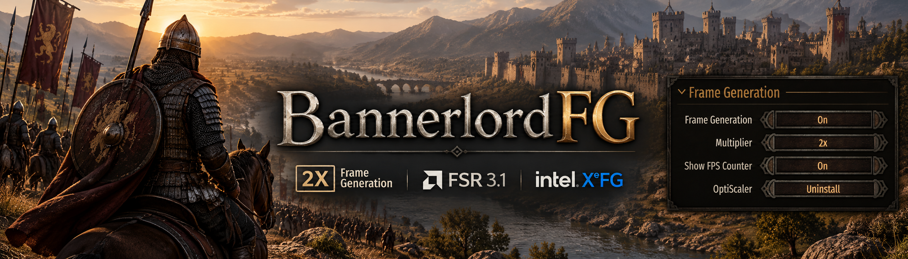
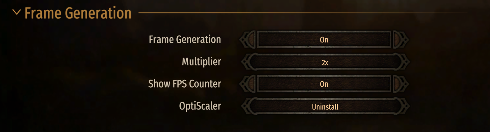
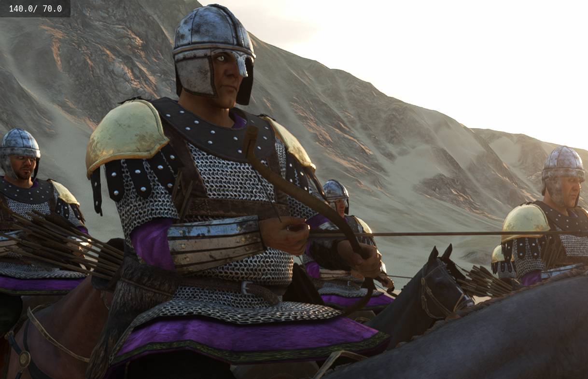

# BannerlordFG



[](https://github.com/luizbizzio/BannerlordFG)   [](LICENSE)

**2x Frame Generation for Mount & Blade II: Bannerlord, built into the game's Performance menu.**

BannerlordFG uses [OptiScaler](https://github.com/optiscaler/OptiScaler) to combine **FSR 3.1 upscaling** with **Intel XeFG**. It inserts one generated frame between frames rendered by Bannerlord, improving perceived smoothness without a separate graphics overlay to configure.

**[Download on Nexus Mods](https://www.nexusmods.com/mountandblade2bannerlord/mods/13629)** · [Source code](https://github.com/luizbizzio/BannerlordFG) · [Report an issue](https://github.com/luizbizzio/BannerlordFG/issues)

## 📦 Installation

1. **[Download the compiled mod ZIP on Nexus Mods](https://www.nexusmods.com/mountandblade2bannerlord/mods/13629)** and extract its `BannerlordFG` folder into `Mount & Blade II Bannerlord/Modules/`.
2. Enable **BannerlordFG** in the game launcher and start Bannerlord.
3. Open **Options → Performance → Frame Generation** and select **OptiScaler → Install**.
4. Confirm the installation. The mod downloads and verifies OptiScaler, then handles the initial restart automatically when possible. Follow the on-screen instructions if a manual relaunch is needed.
5. Set **Frame Generation → On** in the same menu.

The first setup requires an internet connection and may request Windows administrator permission. Version 1.0.2 extracts the verified OptiScaler 7z inside the maintenance DLL using SharpCompress, so the player's Windows `tar.exe` does not need LZMA support. **OptiScaler is downloaded separately; its binaries are not included in the mod ZIP.**

## 🎮 In-game controls

<p align="center">
  <a href="assets/frame-generation.png"></a>
</p>

| Option | What it does |
| --- | --- |
| **Frame Generation** | Turns generated frames on or off. |
| **Multiplier** | Fixed at **2x**: one generated frame between rendered frames. |
| **Show FPS Counter** | Toggles OptiScaler's FPS counter, including generated frames. |
| **OptiScaler** | Installs or uninstalls the graphics component. |

Once initialized, the Frame Generation and FPS counter switches can work without restarting. Some initial setup or backend changes still require a relaunch.

## 🖥️ Compatibility and limitations

- **Windows / DirectX 11 / single-player only.** Windows 11 is the primary target.
- Requires a compatible GPU with **FSR or DLSS support** and an available temporal upscaling backend. NVIDIA, AMD and Intel compatibility varies by GPU and driver.
- Frame Generation increases *displayed* FPS, not the game's simulation speed or real rendering throughput. It can introduce latency or visual artifacts, especially at low base frame rates.
- The mod uses Bannerlord's existing frame limiter. It does not add an unlimited FPS mode or a separate FPS cap.

## ⚙️ How it works

**Same battle. More frames on your screen.** BannerlordFG doesn't make Bannerlord simulate extra soldiers, physics, or game ticks. It fills in some of the visual gaps *between* the frames the game already renders.

### 🎞️ 1. The extra frame trick

Imagine a cavalry charge: Bannerlord renders the horse at position **A**, then at position **B**. Intel XeFG estimates what an image *between those two moments* could look like.

<p align="center">
  <a href="assets/frame-generation-in-game.png"></a>
</p>

```text
What Bannerlord renders:    [ A ] ──────────── [ B ] ──────────── [ C ]
                                     ↓                   ↓
What your screen receives:  [ A ] ─ [ A½B ] ─ [ B ] ─ [ B½C ] ─ [ C ]
                                    generated          generated
```

That is **2x Frame Generation**: one generated image per pair of real frames. The extra images can make motion look smoother, but they **aren't new game-engine updates**. Input handling and battle simulation still depend on your actual rendered frame rate.

| Real frames from Bannerlord | Potential displayed frames with 2x FG |
| ---: | ---: |
| 40 FPS | ~80 FPS |
| 60 FPS | ~120 FPS |
| 90 FPS | ~180 FPS |

> [!NOTE]
> These are examples, **not benchmark results**. Generating frames takes GPU time, output depends on frame pacing, and your monitor can only show as many unique frames as its refresh rate allows. FG may introduce visual artifacts or additional latency.

### 🧩 2. Three components, three different jobs

| Component | What it actually does |
| --- | --- |
| **FSR 3.1** | Reconstructs a higher-resolution image from Bannerlord's lower-resolution render. This is **upscaling**, not frame generation. |
| **Intel XeFG** | Interpolates an additional image between rendered frames. This is the **2x Frame Generation** part. |
| **BannerlordFG + OptiScaler** | Connects these components to Bannerlord's DX11 renderer, adds the native Performance-menu controls, and manages installation. |

Here's the simplified journey of a frame:

```text
Bannerlord renders a frame
          │
          ▼
OptiScaler intercepts the DX11 upscaling path
          │
          ▼
    FSR 3.1 upscaling
          │
          ▼
    Intel XeFG interpolation ──► extra frame between real frames
          │
          ▼
     Presentation to your display
```

**Why does the game sometimes say DLSS?** On NVIDIA systems, Bannerlord may retain its original DLSS-labeled quality selector. BannerlordFG's managed DX11 profile uses **FSR 3.1** underneath, even when that label remains. It **does not use NVIDIA DLSS Frame Generation**. The mod normally selects a compatible quality preset automatically when needed.

### 🔧 3. A peek under the hood

The 2x multiplier isn't an arbitrary FPS boost. The managed OptiScaler profile explicitly requests **one interpolated frame**, with FSR 3.1 as the DX11 upscaler and XeFG as the interpolation backend.

<details>
<summary><b>Show the relevant OptiScaler settings</b></summary>

```ini
[Upscalers]
Dx11Upscaler = fsr31

[FrameGen]
Enabled = true
FGInput = Upscaler
FGOutput = XeFG

[XeFG]
InterpolationCount = 1
ForceBorderless = true
```

`InterpolationCount = 1` is the important line: **one generated frame between two rendered frames**. This is an illustrative excerpt, not a complete configuration file to paste into your game. The mod also avoids an extra FPS limiter and additional sharpening overrides.

</details>

### ⚡ 4. What happens when you click the buttons?

**First-time Install:** BannerlordFG downloads a pinned official OptiScaler release, verifies its **SHA-256** checksum, and prepares the configuration. The graphics files are installed **after Bannerlord exits**. With your confirmation, the mod normally closes and reopens the game automatically, preserving your enabled mods when possible.

**Frame Generation / FPS Counter:** after XeFG and its controls have initialized, the menu can request changes live using internal **F23** (FG) and **F24** (FPS overlay) signals. You don't need to bind or press those keys yourself.

> [!IMPORTANT]
> Live changes are **best-effort**, not confirmed readbacks. The menu reflects the last requested state because OptiScaler doesn't expose the actual runtime state to BannerlordFG. If a toggle has no visible effect, restart the game to apply the saved setting. Initial backend setup can also require a relaunch.

### 🛡️ 5. What if another graphics mod is installed?

BannerlordFG keeps a manifest of the OptiScaler files it installs and checks their hashes before removing them. If it finds an unfamiliar graphics DLL or modified file, it can stop rather than overwrite somebody else's installation.

**Don't delete an unknown `dxgi.dll` to force the installer through.** It may belong to another mod. See the troubleshooting section below if installation is blocked.

## 🛠️ Troubleshooting and removal

| Problem | What to check |
| --- | --- |
| Installation is blocked | Check for an existing OptiScaler installation or another graphics injector. Consult the installation log before changing files. |
| FG cannot be enabled | Confirm that OptiScaler installed and your GPU exposes a compatible upscaling path. If automatic quality selection fails, choose a supported preset in the game's settings. |
| FG / FPS toggle has no visible effect | Restart Bannerlord to apply the saved state. Runtime requests have no independent readback. |
| Unexpected OptiScaler splash | Check for a previous OptiScaler installation; do not remove unknown graphics files blindly. |

**Logs and backups:** `%LOCALAPPDATA%\BannerlordFG`

**Normal uninstall:** **Options → Performance → Frame Generation → OptiScaler → Uninstall**. Follow the prompts before deleting the mod folder. For recovery, close Bannerlord and follow [`RECOVERY_GUIDE.txt`](Module/BannerlordFG/RECOVERY_GUIDE.txt). The packaged recovery script is `Modules/BannerlordFG/UNINSTALL_WINDOWS.ps1`.

When [reporting a bug](https://github.com/luizbizzio/BannerlordFG/issues), include the mod version, game version, GPU and driver, reproduction steps, and relevant logs. Remove personal information first; see [SECURITY.md](SECURITY.md) for private vulnerability reports.

## 🧰 Building from source

Requires an installed copy of Bannerlord, **Visual Studio 2022 Build Tools / MSBuild**, and the **.NET Framework 4.7.2 targeting pack**. With the game closed, update the `GAME` path in [`BUILD_WINDOWS.cmd`](BUILD_WINDOWS.cmd) if needed and run it as administrator.

The build restores the SharpCompress NuGet dependency (including runtime libraries), downloads Harmony when needed, compiles `BannerlordFG.dll` and `BannerlordFG.Maintenance.dll`, packages `BannerlordFG-v1.0.2.zip`, and deploys the build to the configured game directory. The Python source-contract tests **do not** replace a Windows build or an in-game test.

## ❤️ Credits and license

BannerlordFG uses [OptiScaler](https://github.com/optiscaler/OptiScaler), AMD FSR 3.1, Intel XeFG, [SharpCompress](https://github.com/adamhathcock/sharpcompress), and [Harmony](https://github.com/pardeike/Harmony). **Special thanks to [Shaddawen](https://www.nexusmods.com/profile/Shaddawen)** for her help and support during development.

Original BannerlordFG code is licensed under **[GPL-3.0-only](LICENSE)**. See the [third-party notices](THIRD_PARTY_NOTICES.txt) for component licenses. This is an independent community project, not affiliated with or endorsed by TaleWorlds Entertainment or the third-party projects above.
