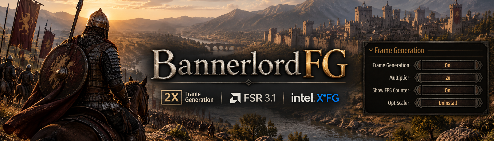
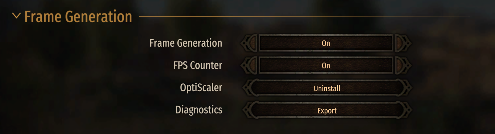

# BannerlordFG

**2x Frame Generation for Mount & Blade II: Bannerlord, directly in the Performance menu.**

[**Download on Nexus Mods**](https://www.nexusmods.com/mountandblade2bannerlord/mods/13629) · [**GitHub Releases**](https://github.com/luizbizzio/BannerlordFG/releases) · [Report a problem](https://github.com/luizbizzio/BannerlordFG/issues)

BannerlordFG adds **Intel XeFG Frame Generation** to Bannerlord through [OptiScaler](https://github.com/optiscaler/OptiScaler). It combines **FSR 3.1 upscaling** with **2x frame generation**, inserting one generated frame between rendered frames.

It uses the game's native options menu. No separate application is needed to manage installation or turn Frame Generation on and off.

## Installation

1. Download the compiled mod from [Nexus Mods](https://www.nexusmods.com/mountandblade2bannerlord/mods/13629).
2. Extract the **`BannerlordFG`** folder into `Mount & Blade II Bannerlord/Modules/`.
3. Enable **BannerlordFG** in the game launcher, then start Bannerlord.
4. Open **Options > Performance > Frame Generation** and select **OptiScaler > Install**.
5. Follow the on-screen instructions. After the files are downloaded and verified, the game closes so the installer can finish. **Wait for installation to complete, then start Bannerlord manually.**
6. Return to the same menu and set **Frame Generation > On**.

The first installation needs an internet connection and may require administrator permission. BannerlordFG downloads and verifies the official **OptiScaler `nightly-20261116`** separately. **OptiScaler binaries are not included in the BannerlordFG download.**

## In-game controls

  

| Option | Action |
| --- | --- |
| **Frame Generation** | Turn 2x Frame Generation on or off. |
| **FPS Counter** | Show or hide OptiScaler's FPS counter. |
| **OptiScaler** | Install or uninstall OptiScaler. |
| **Diagnostics** | Export a diagnostic ZIP and open its location in File Explorer. |

The multiplier is fixed at **2x**. The menu shows the last requested state; a successful toggle does not prove that the graphics backend is generating frames. Some changes may require restarting the game.

## Compatibility

- **Windows, DirectX 11 and single-player.** Windows 11 is the main tested platform.
- **GPU support varies.** Results depend on the graphics card, driver and available upscaling features.
- **Other graphics mods:** the managed installer checks for occupied proxy DLL names. It prefers `winmm.dll`, can use `dxgi.dll` if that name is free, and does not overwrite unknown files.

> [!NOTE]
> Frame Generation can make motion look smoother, but it does not double game simulation speed or input responsiveness. It uses GPU resources and can increase latency or cause visual artifacts.

### ReShade

On the original Bannerlord launcher, OptiScaler using `winmm.dll` was tested alongside ReShade 6.8.0 using either `dxgi.dll` or `d3d11.dll`. Compatibility may vary between game versions, drivers and other graphics mods.

If another component needs the `dxgi.dll` filename, you can move **ReShade's own** `dxgi.dll` to `d3d11.dll` while the game is closed. First verify that `dxgi.dll` belongs to ReShade and that `d3d11.dll` does not already exist. Back up the original file and **never overwrite an unknown DLL**. See [OptiScaler's compatibility guide](https://github.com/optiscaler/OptiScaler/wiki/Compatibility-with-other-mods-%28Reshade%2C-SpecialK%29) for other setups.

### BLSE compatibility

**BLSE is not fully supported by the automatic OptiScaler installation.** With BLSE 1.7.5, both `Bannerlord.BLSE.Launcher.exe` and `Bannerlord.BLSE.LauncherEx.exe` were observed loading the Windows system `WINMM.dll` instead of OptiScaler's local `winmm.dll`. In that case, installing OptiScaler through BannerlordFG does not make Frame Generation work.

**Recommended:** use the **original Bannerlord launcher** with the managed OptiScaler installation.

**If you need BLSE**, you can try this advanced manual setup:

1. Close the game. Open Bannerlord through the original launcher and choose **OptiScaler > Uninstall** to remove the BannerlordFG-managed installation. Wait until removal is complete.
2. Make sure the game's `dxgi.dll` filename is available. If ReShade owns it, follow the [ReShade instructions](#reshade) above. Do not overwrite any existing DLL.
3. Follow [OptiScaler's official manual installation guide](https://github.com/optiscaler/OptiScaler/wiki/Manual-Installation), choosing the upstream `dxgi.dll` proxy where supported.
4. Start the game with BLSE and verify that OptiScaler loads and XeFG actually generates frames. If you use ReShade, check its overlay separately.

**This is an unverified workaround, not guaranteed BLSE support.** BannerlordFG cannot manage or uninstall OptiScaler files installed manually. If it does not work, remove only the files you can positively identify as belonging to that manual installation, following upstream guidance, and return to the original launcher.

> [!WARNING]
> **Never rename BannerlordFG-managed `winmm.dll` to `dxgi.dll`.** The installer records the proxy filename and hash for safe removal. Renaming it can break uninstall and recovery. Do not replace `dbghelp.dll` or Windows system DLLs to force loading.

## Diagnostics and troubleshooting

Select **Options > Performance > Frame Generation > Diagnostics > Export**. BannerlordFG creates a ZIP in `%LOCALAPPDATA%\BannerlordFG\Diagnostics` and opens File Explorer with the exported file selected.

The ZIP can include hardware details, game and mod information, graphics status and available logs. Current and historical warnings are separated. Logs are redacted during export, but **review the ZIP before sharing it publicly**.

| Problem | What to do |
| --- | --- |
| OptiScaler does not start with BLSE | Read [BLSE compatibility](#blse-compatibility). The local `winmm.dll` may not load. |
| Installation is blocked | Check whether another graphics mod owns `winmm.dll` or `dxgi.dll`. Do not overwrite it. |
| Frame Generation has no visible effect | Confirm OptiScaler is loaded, check a supported upscaling preset, and restart the game. |
| ReShade overlay is missing | Check its DLL filename and the [ReShade section](#reshade). |
| Install or uninstall fails | Export diagnostics and check `%LOCALAPPDATA%\BannerlordFG\BannerlordFG.log`. |

OptiScaler logging is enabled at **Info** level for new managed installations. BannerlordFG does not delete or truncate an active OptiScaler log. Older logs may remain for troubleshooting.

## Uninstalling and updating

To remove the managed graphics component, open **Options > Performance > Frame Generation > OptiScaler > Uninstall** and follow the prompts. **Do this before deleting the BannerlordFG module folder.**

For an upgrade from an older managed installation, uninstall its OptiScaler component before replacing the module with a newer build. Updating the module alone does not automatically replace OptiScaler.

If normal removal fails, close Bannerlord and follow [`RECOVERY_GUIDE.txt`](Module/BannerlordFG/RECOVERY_GUIDE.txt). The release package also includes `UNINSTALL_WINDOWS.ps1` for recovery. Do not delete proxy DLLs manually unless you have confirmed ownership.

## Building from source

Requires Bannerlord installed on Windows, Visual Studio 2022 Build Tools / MSBuild, and the .NET Framework 4.7.2 targeting pack. See [`BUILD_WINDOWS.cmd`](BUILD_WINDOWS.cmd) for the configured game path and build steps.

**Warning:** `BUILD_WINDOWS.cmd` also deploys the built module into the configured game installation. Close Bannerlord and review the script before running it. Dependencies such as Harmony and SharpCompress are obtained by the build process.

## Credits and license

BannerlordFG uses [OptiScaler](https://github.com/optiscaler/OptiScaler), [Intel XeFG](https://www.intel.com/), [AMD FidelityFX](https://gpuopen.com/fidelityfx-super-resolution/), [Harmony](https://github.com/pardeike/Harmony) and [SharpCompress](https://github.com/adamhathcock/sharpcompress).

Special thanks to [Shaddawen](https://www.nexusmods.com/profile/Shaddawen) for her help during development.

Original BannerlordFG code is licensed under **[GPL-3.0-only](LICENSE)**. Third-party licenses and notices are listed in [`THIRD_PARTY_NOTICES.txt`](THIRD_PARTY_NOTICES.txt). This project is not affiliated with TaleWorlds or the projects listed above.
